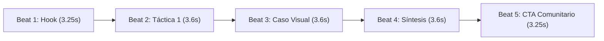

# Guía Maestra · Producción de Videos Cinéticos Verticales con IA (Playbook Transferible)

> **Destino:** Guía técnica, metodológica y operativa para replicar en cualquier proyecto la arquitectura de video con IA utilizada en la trilogía de reels de **Google Gemini** (Niveles 1, 2 y 3) para redes sociales (TikTok, Instagram Reels, YouTube Shorts).

---

## 📑 Tabla de Contenidos

1. [Visión General y Filosofía de Diseño](#1-visión-general-y-filosofía-de-diseño)
2. [Stack Tecnológico y Herramientas](#2-stack-tecnológico-y-herramientas)
3. [Ecosistema de Agent Skills (Google Antigravity)](#3-ecosistema-de-agent-skills-google-antigravity)
4. [Estructura Narrativa y Cadencia de Retención (5 Beats)](#4-estructura-narrativa-y-cadencia-de-retención-5-beats)
5. [Técnicas de Motion Design y Física Cinética](#5-técnicas-de-motion-design-y-física-cinética)
6. [Diseño y Capas de Audio (Sound Design)](#6-diseño-y-capas-de-audio-sound-design)
7. [Arquitectura de Código Modular (React + Remotion + Zod)](#7-arquitectura-de-código-modular-react--remotion--zod)
8. [Alternativa Ligera: HyperFrames & GSAP](#8-alternativa-ligera-hyperframes--gsap)
9. [Flujo Paso a Paso para Implementar en un Nuevo Proyecto](#9-flujo-paso-a-paso-para-implementar-en-un-nuevo-proyecto)
10. [Comandos de CLI y Scripts de Automatización](#10-comandos-de-cli-y-scripts-de-automatización)

---

## 1. Visión General y Filosofía de Diseño

El objetivo central de este sistema es **producir videos verticales de 1080×1920 a 60 FPS**, dirigidos por código determinista y contenido estructurado, eliminando las limitaciones de los editores manuales de video y evitando el aspecto genérico de baja calidad ("AI slop").

### Principios Fundamentales:
* **Foco y Agilidad (16.5s a 17.5s):** En plataformas de formato corto, un video de más de 30 segundos sin dinamismo extremo pierde más del 70% de retención. Los videos de Gemini se calibraron a ~1040 fotogramas a 60 FPS (~17.3 segundos).
* **Contenido Autoconclusivo (Self-Contained):** El espectador comprende el problema, la solución técnica y la conclusión sin requerir contexto previo.
* **Cero Sobrecontextualización:** Cada escena es escaneable en 3 segundos. Titulares cortos, énfasis semántico en palabras clave (`*resaltado*`), datos visuales y cero párrafos densos.
* **Eliminación de Elementos Parásitos:** Se eliminaron corchetes HUD innecesarios y barras de progreso fragmentadas para priorizar una estética limpia, sobria y de alto impacto visual (estilo Apple Design Studio / Stripe Press).
* **Determinismo Absoluto:** Todo fotograma visual, movimiento o sonido es una función pura del tiempo transcurrido (`useCurrentFrame()`). No existen temporizadores asíncronos (`setTimeout`), fechas de sistema (`Date.now()`) ni valores aleatorios no reproducibles (`Math.random()`).

---

## 2. Stack Tecnológico y Herramientas

| Herramienta / Paquete | Versión | Rol en el Sistema |
|---|---|---|
| **Remotion Core** (`remotion`) | `^4.0.534` | Motor de composición y renderizado cuadro por cuadro en React 19. |
| **Remotion CLI** (`@remotion/cli`) | `^4.0.534` | Servidor de desarrollo en vivo (`remotion studio`) y motor de exportación. |
| **Motion Blur** (`@remotion/motion-blur`) | `4.0.534` | Desenfoque por obturación cinemática en paneos de cámara 3D. |
| **Media Utils** (`@remotion/media-utils`) | `4.0.534` | Detección de dimensiones y decodificación de audio en memoria. |
| **Zod** (`zod`) | `3.22.3` | Validación de contratos de datos para escenas, temas y colores. |
| **React & React-DOM** | `19.2.3` | Sistema declarativo de componentes e interfaces modulares. |
| **TypeScript** | `5.9.3` | Tipado estricto para evitar errores de renderizado en compilación. |
| **GSAP (GreenSock)** | `3.14.2` | Motor de animación para la variante alternativa de HyperFrames (HTML/Web). |
| **PowerShell & Node.js** | `>= 20.x` | Automatización de compilaciones por lotes y encadenamiento de colas. |

---

## 3. Ecosistema de Agent Skills (Google Antigravity)

Para que el modelo de IA opere como un director técnico y de arte autónomo, se integró una serie de **Agent Skills** especializadas bajo el directorio `.agents/skills/`:

### 1. `remotion-motion-design`
* **Misión:** Garantiza que las animaciones utilicen física de resortes elásticos (`spring()`), cálculo de amortiguación crítica ($\zeta \in [0.72, 0.98]$), derivas espaciales continuas (*continuous drift*) y revelado tipográfico por máscaras (`overflow: hidden`).
* **Regla estricta:** Prohíbe transiciones CSS mecánicas y animaciones lineales.

### 2. `remotion-best-practices` & `remotion-render`
* **Misión:** Optimiza el rendimiento de la CPU/GPU al renderizar.
* **Buenas prácticas:** Control de concurrencia (`--concurrency=4` o `75%`), compresión con CRF balanceado (`--crf=16`), precarga de escenas (`premountFor={fps}`) y renderizado condicional de desenfoque.

### 3. `remotion-markup`
* **Misión:** Patrones de estructura de subtítulos, badges, destacados de sintaxis y temporizado por transiciones.

### 4. `hyperframes` & `hyperframes-animation`
* **Misión:** Permite compilar y previsualizar la línea de tiempo en el navegador mediante HTML puro y JavaScript sin dependencias pesadas de React, registrando la línea de tiempo en `window.__timelines["main"]`.

### 5. `svg-icon-generator`
* **Misión:** Crea o normaliza iconos vectoriales SVG limpios (Google Drive, Docs, Sheets, Meet, Gmail, Gemini Star) para que pesen pocos kilobytes y no introduzcan distorsión a 1080×1920.

---

## 4. Estructura Narrativa y Cadencia de Retención (5 Beats)

Los 3 videos de Gemini siguen una estructura rigurosa de **5 secuencias (beats)**:



### Detalle de Escenas Aplicadas en los Videos de Gemini:

| Beat | Tipo de Escena | Objetivo Narrativo | Duración en Frames (60 FPS) | Elementos Clave |
|---|---|---|---|---|
| **1. Hook** | `hero` | Romper la suposición del usuario. | 195 frames (~3.25 s) | Badge brillante, titular con acento, AnimatedGeminiLogo, SFX Impact + Sparkle. |
| **2. Táctica 1** | `points` | Explicar el método accionable. | 215–220 frames (~3.6 s) | 3 puntos secuenciales con numeración y descripción concisa, iconos SVG. |
| **3. Showcase** | `showcase` | Prueba empírica / caso real. | 215–220 frames (~3.6 s) | Imagen de alta calidad (Drive, Pizarra, Sidepanel, Gemini Spark) con marco iluminado. |
| **4. Síntesis** | `points` | Automatización o rol en vivo. | 215–220 frames (~3.6 s) | Escalabilidad del sistema (Meet, Sheets, Acciones programadas). |
| **5. CTA** | `cta` | Conversión y compromiso. | 195 frames (~3.25 s) | Palabra clave central destacada (ej: `GEMINI`, `WORKSPACE`, `SISTEMAS`). |

### Algoritmo de Cadencia Lectora (`computeReadingCadence`):
Para calcular de forma matemática la duración en fotogramas de cualquier escena a partir del texto:
$$\text{durationFrames} = \text{FPS} \cdot \max\left(1.8, \, 0.55 + \frac{60 \cdot W}{\text{WPM}} + 0.045 \cdot S \cdot C + 0.75\right)$$
* $W$: Número de palabras.
* $\text{WPM}$: Palabras por minuto (recomendado: 210 WPM).
* $S$: Conteo aproximado de sílabas.
* $C$: Modificador de complejidad conceptual (1.0 general, 1.25 para términos técnicos).

---

## 5. Técnicas de Motion Design y Física Cinética

### A. Resortes Elásticos Subamortiguados (`useSpring`)
Se descartan curvas estáticas. Se utiliza la física de resortes calibrada para entrada de textos, tarjetas y badges:

```typescript
// Hook de resorte estándar para entradas ágiles y con peso cinematográfico
export const useSpring = (delay: number, damping = 22, stiffness = 210) => {
  const frame = useCurrentFrame();
  const { fps } = useVideoConfig();
  return spring({
    frame: frame - delay,
    fps,
    config: { damping, stiffness, mass: 0.7 },
  });
};
```

### B. Tipografía Cinética con Revelado por Máscara (`KineticText.tsx`)
Cada palabra se fragmenta y aparece emergiendo desde una máscara oculta (`overflow: hidden`), con un retardo acumulativo basado en la longitud de las palabras precedentes:

```tsx
<div style={{ overflow: "hidden", display: "inline-flex" }}>
  <span
    style={{
      transform: `translateY(${(1 - enter) * 100}%)`,
      opacity: enter,
      color: isHighlighted ? theme.accent : "#FFFFFF",
    }}
  >
    {word}
  </span>
</div>
```

### C. Deriva Espacial Continua (*Continuous Drift*)
Para evitar el "efecto congelado" cuando el texto termina de entrar, la escena mantiene una deriva matemática suave en escala (del 1.0 al 1.025, o leve traslación en Z):

```typescript
const driftScale = interpolate(
  frame,
  [0, durationInFrames],
  [1.0, 1.025],
  { extrapolateLeft: "clamp", extrapolateRight: "clamp" }
);
```

### D. Cámara Virtual 3D con Motion Blur Condicional (`CameraRig.tsx`)
Mueve el lienzo en los tres ejes espaciales. La clave de rendimiento reside en calcular la velocidad entre fotogramas y activar el componente `<CameraMotionBlur>` **únicamente** cuando la cámara se encuentra en movimiento acelerado, reduciendo el tiempo de render hasta 3 veces:

```typescript
const isMoving = speed > 0.05;
return isMoving ? (
  <CameraMotionBlur samples={samples}>{content}</CameraMotionBlur>
) : (
  content
);
```

### E. Logotipo Cinético Reactivo (`AnimatedGeminiLogo.tsx`)
Presenta el isotipo de cuatro puntas con:
* Entrada elástica inicial con resorte.
* Oscilación senoidal continua de respiración (`Math.sin(frame / 16) * 12px`).
* Resplandor reactivo neón (`boxShadow` / `dropShadow`) sincronizado con los fotogramas.

---

## 6. Diseño y Capas de Audio (Sound Design)

La producción de video incluye un ecosistema sonoro completo integrado en el compositor:

```
[Timeline de Audio]
├── BGM: tech_ambient_bed.mp3 ──────────────────────── (Loop continuo, volumen 0.13, fade-in/out)
├── Beat 1 (0.0s):  [whoosh-short] + [impact-bass-1] + [sparkle]
├── Beat 2 (3.2s):  [whoosh-short] + [pop]
├── Beat 3 (6.8s):  [whoosh-short] + [impact-bass-2]
├── Beat 4 (10.4s): [whoosh-short] + [pop]
└── Beat 5 (14.0s): [whoosh-short] + [chime]
```

### Implementación en Remotion (`Reel.tsx`):
```tsx
{/* Cama sonora de fondo (BGM) con fundido analítico */}
<Audio
  src={staticFile("bgm/tech_ambient_bed.mp3")}
  volume={(f) => {
    const fadeIn = Math.min(1, f / (fps * 0.5));
    const fadeOut = Math.min(1, (total - f) / (fps * 0.5));
    return 0.13 * Math.max(0, fadeIn) * Math.max(0, fadeOut);
  }}
  loop
/>

{/* SFX reactivo a la escena actual */}
<Audio src={staticFile("sfx/whoosh-short.mp3")} volume={0.35} />
{s.type === "hero" && (
  <>
    <Audio src={staticFile("sfx/impact-bass-1.mp3")} volume={0.55} />
    <Sequence from={14}>
      <Audio src={staticFile("sfx/sparkle.mp3")} volume={0.4} />
    </Sequence>
  </>
)}
```

---

## 7. Arquitectura de Código Modular (React + Remotion + Zod)

La estructura del directorio de video debe replicarse con el siguiente árbol:

```
remotion-video-system/
├── package.json
├── remotion.config.ts
├── tsconfig.json
├── public/
│   ├── assets/          # Logos SVG, capturas reales de pantalla
│   ├── bgm/             # tech_ambient_bed.mp3
│   └── sfx/             # whoosh, impact, pop, click, sparkle, chime
└── src/
    ├── index.ts         # Punto de entrada
    ├── Root.tsx         # Registro de <Composition />
    ├── Reel.tsx         # Orquestador general (Backdrop + Secuencias + Audio)
    ├── components/
    │   ├── AnimatedGeminiLogo.tsx
    │   ├── Backdrop.tsx
    │   ├── CameraRig.tsx
    │   ├── KineticText.tsx
    │   └── Scenes.tsx   # HeroScene, PointsScene, ShowcaseScene, CtaScene
    ├── data/
    │   ├── geminiNivel1.ts
    │   ├── geminiNivel2.ts
    │   └── geminiNivel3.ts
    └── lib/
        ├── cadence.ts   # Cálculo de duraciones por lectura
        ├── schema.ts    # Esquemas Zod para tipado
        ├── theme.ts     # Paletas de color, márgenes y fuentes
        └── timeline.ts  # Construcción de tiempos y offsets
```

### Contrato Zod de Escena (`src/lib/schema.ts`):
```typescript
import { z } from "zod";

export const SceneSchema = z.discriminatedUnion("type", [
  z.object({
    type: z.literal("hero"),
    badge: z.string(),
    kicker: z.string().optional(),
    title: z.string(),
    sub: z.string().optional(),
    showLogo: z.boolean().optional(),
    durationFrames: z.number().optional(),
  }),
  z.object({
    type: z.literal("points"),
    badge: z.string(),
    title: z.string(),
    sub: z.string().optional(),
    points: z.array(z.object({ label: z.string(), desc: z.string() })),
    icons: z.array(z.string()).optional(),
    durationFrames: z.number().optional(),
  }),
  z.object({
    type: z.literal("showcase"),
    badge: z.string(),
    title: z.string(),
    sub: z.string().optional(),
    image: z.string(),
    imageCaption: z.string().optional(),
    icons: z.array(z.string()).optional(),
    durationFrames: z.number().optional(),
  }),
  z.object({
    type: z.literal("cta"),
    badge: z.string(),
    title: z.string(),
    keyword: z.string(),
    line: z.string(),
    durationFrames: z.number().optional(),
  }),
]);

export const ReelPropsSchema = z.object({
  brand: z.string(),
  kicker: z.string(),
  scenes: z.array(SceneSchema),
});
```

---

## 8. Alternativa Ligera: HyperFrames & GSAP

Para casos donde no se desee levantar el entorno completo de Node/React o se busque previsualización ultrarrápida en navegadores móviles, se implementó el formato **HyperFrames (HTML5 + GSAP)** (como en `gemini-nivel-1/index.html`):

1. **Estructura HTML Pura:** Un único archivo `index.html` con atributos de composición:
   ```html
   <div id="root" data-composition-id="main" data-width="1080" data-height="1920" data-duration="16.5">
   ```
2. **Animación con GSAP Timelines:**
   ```javascript
   const tl = gsap.timeline({ paused: true });
   tl.fromTo("#b1-title", { y: 40, opacity: 0 }, { y: 0, opacity: 1, duration: 0.65, ease: "power3.out" }, 0.25);
   tl.to(["#b1-badge", "#b1-title", "#b1-sub"], { y: -35, opacity: 0, duration: 0.4, ease: "power3.in" }, 3.4);
   
   // Exposición del contrato para HyperFrames / renderizador
   window.__timelines = window.__timelines || {};
   window.__timelines["main"] = tl;
   ```
3. **Ventaja:** Cero compilación previa, previsualización instantánea abriendo el archivo localmente o sirviéndolo por HTTP simple.

---

## 9. Flujo Paso a Paso para Implementar en un Nuevo Proyecto

Para clonar esta capacidad en un nuevo proyecto, sigue estos pasos:

### Paso 1: Inicializar el Proyecto de Video
En la raíz o en una subcarpeta (por ejemplo `/video-engine`):
```bash
npm init -y
npm install remotion@4.0.534 @remotion/cli@4.0.534 @remotion/motion-blur@4.0.534 @remotion/media-utils@4.0.534 @remotion/google-fonts@4.0.534 @remotion/renderer@4.0.534 react@19.2.3 react-dom@19.2.3 zod@3.22.3
npm install -D typescript @types/react@19.2.7 prettier
```

### Paso 2: Configurar `remotion.config.ts`
```typescript
import { Config } from "@remotion/cli/config";

Config.setVideoImageFormat("jpeg");
Config.setOverwriteOutput(true);
Config.setChromiumOpenGlRenderer("angle");
```

### Paso 3: Copiar la Estructura de Skills de Agente
Copia la carpeta de skills a tu nuevo repositorio:
```bash
mkdir -p .agents/skills
# Copiar las skills: remotion-motion-design, remotion-best-practices, remotion-markup, remotion-render
```

### Paso 4: Instalar los Assets de Audio y Gráficos
Coloca en `public/`:
* `sfx/`: `whoosh-short.mp3`, `impact-bass-1.mp3`, `impact-bass-2.mp3`, `sparkle.mp3`, `pop.mp3`, `click.mp3`, `chime.mp3`.
* `bgm/`: `tech_ambient_bed.mp3`.
* `assets/`: Logotipo en SVG y capturas reales de demostración.

### Paso 5: Declarar el Archivo de Datos del Video
Crea un archivo TypeScript (ejemplo `src/data/miNuevoVideo.ts`) implementando el esquema `ReelProps`:
```typescript
import type { ReelProps } from "../lib/schema";

export const miVideoData: ReelProps = {
  brand: "gemini_lvl1",
  kicker: "MI PROYECTO · EDICIÓN MAESTRA",
  scenes: [
    {
      type: "hero",
      badge: "EL GRAN PROBLEMA",
      title: "¿Sigues haciendo esto *a mano*?",
      sub: "Te enseño cómo automatizarlo en 3 minutos.",
      showLogo: true,
      durationFrames: 195,
    },
    // ...resto de los 5 beats
  ],
};
```

### Paso 6: Registrar la Composición en `Root.tsx`
```tsx
<Composition
  id="MiNuevoVideoReel"
  component={Reel}
  schema={ReelPropsSchema}
  defaultProps={miVideoData}
  durationInFrames={1040}
  fps={60}
  width={1080}
  height={1920}
/>
```

---

## 10. Comandos de CLI y Scripts de Automatización

### 1. Iniciar Remotion Studio (Previsualización Interactiva)
```bash
npx remotion studio
```
Abre la interfaz visual en `http://localhost:3000` con barra de reproducción cuadro a cuadro, inspector de propiedades e inspección de audio.

### 2. Renderizar un Video Individual a MP4
```bash
# Renderizado de alta calidad a 60 FPS con aceleración multihilo
npx remotion render GeminiNivel1Reel out/gemini_nivel_1_basico.mp4 --concurrency=4 --crf=16 --overwrite
```

### 3. Script PowerShell para Renderizado en Cola por Lotes
Para renderizar múltiples reels de forma encadenada y desatendida sin saturar la memoria GPU:

```powershell
$reels = @("GeminiNivel1Reel", "GeminiNivel2Reel", "GeminiNivel3Reel")
$outDir = "..\videos"

if (!(Test-Path $outDir)) { New-Item -ItemType Directory -Path $outDir }

foreach ($reel in $reels) {
    Write-Host "Iniciando renderizado de: $reel ..." -ForegroundColor Cyan
    $outputFile = Join-Path $outDir "$reel.mp4"
    npx remotion render $reel $outputFile --overwrite --concurrency=4 --crf=16
    Write-Host "Finalizado: $outputFile" -ForegroundColor Green
}
```

---

## 💡 Resumen Rápido de Validación (Checklist)

Antes de exportar el video a producción, verifica:
- [ ] **Resolución:** Exactamente 1080×1920 a 60 FPS.
- [ ] **Duración:** Entre 16.5s y 18s (para máxima retención).
- [ ] **Márgenes Seguros:** Textos alejados a más de 120px de los bordes laterales y 160px de la parte inferior para evitar solapamiento con los botones de TikTok/Instagram.
- [ ] **Audio:** Volumen de música de fondo atenuado (`0.12 - 0.15`), golpes de efectos sonoros (SFX) balanceados entre `0.35` y `0.55`.
- [ ] **Texto:** Máximo 2 a 3 líneas por frase; uso de `*asteriscos*` para destacar palabras clave con el color de acento.
